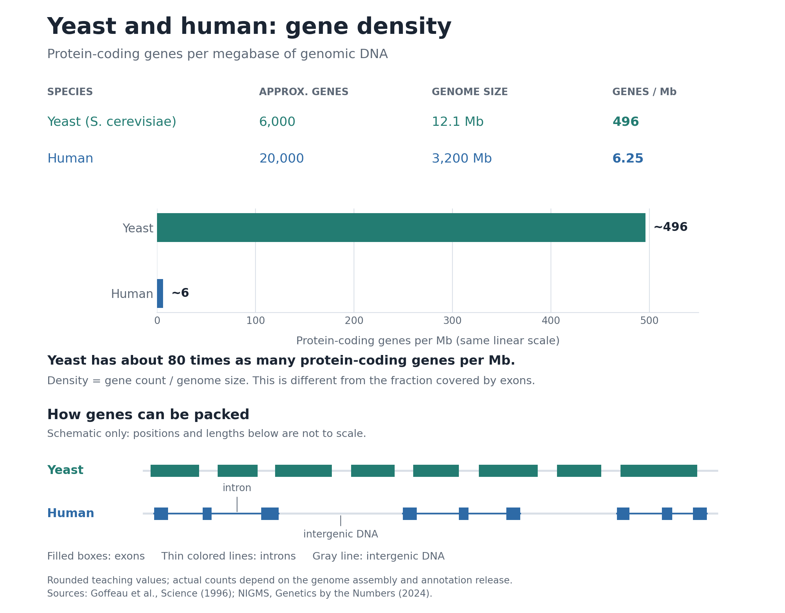

# Week 1 Session 1: Command Line, Text Processing, and Git

Applied Bioinformatics - Tufts University Department of Biology

In this lab you will log in to the Tufts HPC cluster, orient yourself in the filesystem, inspect a real GFF3 annotation file, practice common Unix text-processing patterns, and create your first Git repository for course work.

## Before You Start

You need a terminal on the Tufts HPC cluster, Pax.

Option A: OnDemand

1. Go to <https://ondemand-prod.pax.tufts.edu/>.
2. Log in with your Tufts UTLN and password, then complete 2FA.
3. Open **Clusters > Tufts HPC Shell Access**.

Option B: SSH

```bash
ssh your_utln@login-prod.pax.tufts.edu
```

You should land in your home directory, with a path like `/cluster/home/your_utln`, on a login node with a name like `login-p01`.

## Shared Setup

We can set up a few environment variables to store the course paths we will use repeatedly. This is a common practice in bioinformatics pipelines.

```bash
export COURSE=/cluster/tufts/c27sp1bio0196
export MYWORK="$COURSE/$USER"
export WEEK1_DATA=$COURSE/shared/wk1
ls "$WEEK1_DATA"
```

`$MYWORK` is your own directory in the course allocation: all your work goes there. The shared course files sit in a separate location, `$WEEK1_DATA`, which you read but do not write to.

Expected file:

```text
anno.gff3
```

Do not run real software on the login node. The commands in this lab are tiny and safe; Lab 2 introduces how to request a compute node.

## Part 1: Where Am I?

### 1.1 Orient Yourself

```bash
pwd
whoami
hostname
ls -lha
```

**Question 1.** What is the full path to your home directory?

<details>
<summary>Answer</summary>
At Tufts HPC, your home directory is `/cluster/home/your_utln`.
</details>
### 1.2 Make a Working Directory

```bash
mkdir -p "$MYWORK/week-01/session-01"
cd "$MYWORK/week-01/session-01"
pwd
```

### 1.3 Relative and Absolute Paths

```bash
ls "$WEEK1_DATA"      # absolute path through a variable
ls ../                # relative path; depends where you are
cd ..
pwd
cd -                  # return to the previous directory
pwd
```

**Question 2.** If you are in `$MYWORK/week-01/session-01`, what does `../..` refer to?

<details>
<summary>Answer</summary>

`..` is `$MYWORK/week-01`, so `../..` is `$MYWORK`.

</details>

### 1.4 Link the Data Instead of Copying It

```bash
cd "$MYWORK/week-01/session-01"
ln -sf "$WEEK1_DATA/anno.gff3" .
ls -la
```

The arrow in the listing shows that `anno.gff3` is a symbolic link. You can use the file without making a second copy, which matters when the file is 40 GB instead of 40 KB.

**Checkpoint 1.** You should be in `$MYWORK/week-01/session-01` with one symbolic link to `anno.gff3`.

## Part 2: Interrogating a Real Annotation File

`anno.gff3` is a genome annotation file: one feature per line, nine tab-separated columns.

### 2.1 Look Before You Leap

```bash
less anno.gff3
wc -l anno.gff3
```

Press `q` to leave `less`.

Lines starting with `#` are not data. Most are the `###` separators Ensembl writes after each gene, not headers. Compare these counts:

```bash
grep -c '' anno.gff3       # count every line
grep -c '^#' anno.gff3     # headers and ### separators — expect thousands, not five
grep -vc '^#' anno.gff3    # count data lines only
```

### 2.2 `cut`: Pull Out Columns

Column 3 is the feature type.

```bash
grep -v '^#' anno.gff3 | cut -f3 | head
```

### 2.3 The Counting Idiom

This four-stage pattern is used constantly in bioinformatics. Build it up one stage at a time and watch what each command adds.

```bash
grep -v '^#' anno.gff3 | cut -f3 | head
grep -v '^#' anno.gff3 | cut -f3 | sort | head
grep -v '^#' anno.gff3 | cut -f3 | sort | uniq -c
grep -v '^#' anno.gff3 | cut -f3 | sort | uniq -c | sort -rn
```

- cut -f3 — pull out the one column you want to count
- sort — bring identical values next to each other
- uniq -c — collapse the runs and count them
- sort -rn — put the biggest counts first

**Question 3.** Remove the `sort` before `uniq -c` and run the command again. What happens, and why?

<details>
<summary>Answer</summary>

`uniq` only collapses lines that are already adjacent. Without `sort`, identical feature types scattered through the file are not brought together, so you get a long list of small counts instead of one count per type.

It produces no error. It just quietly gives the wrong answer, which is the point of the exercise.

</details>

### 2.4 `awk`: Filter on a Column

```bash
awk -F'\t' '$3 == "gene"' anno.gff3 | wc -l
```

The `-F` option sets the field separator to a tab. Use it for GFF3 because the attributes column can contain spaces.

Count genes per chromosome:

```bash
awk -F'\t' '$3 == "gene"' anno.gff3 | cut -f1 | sort | uniq -c | sort -rn
```

### 2.5 `awk`: Do Arithmetic Across Lines

So far `awk` has been filtering lines. It can also accumulate a running total as it reads,
which is how you answer questions about quantity rather than count.

Columns 4 and 5 are the start and end coordinates of each feature. This adds up the length
of every exon in the file:

```bash
awk -F'\t' '$3 == "exon" { s += $5 - $4 + 1 } END { print s }' anno.gff3
```

Four things are happening:

```text
-F'\t'                 split each line on tabs
$3 == "exon"           only act on rows where column 3 is exon
{ s += $5 - $4 + 1 }   add this exon's length to a running total called s
END { print s }        after the last line, print the total once
```

`awk` creates `s` the first time you use it and starts it at zero, so there is nothing to
declare. The block in braces runs once per matching line; the `END` block runs once, at the
very end.

**Question 4.** Why is there a `+ 1`? Run the command without it and see how much the
answer changes.

<details>
<summary>Answer</summary>

GFF3 coordinates are **1-based and inclusive**: the first base of a sequence is base 1, and
both the start and end coordinates are part of the feature. A feature from 100 to 110
therefore covers eleven bases, not ten.

BED format is different. It is **0-based and half-open**, so the same region is written
99 to 110 and its length really is `end - start`, with no `+ 1`.

Drop the `+ 1` and your total is short by exactly one base per exon. With roughly 7,500
exons in this file that is about 7,500 bases missing — a small enough error to look
entirely plausible, which is what makes it dangerous.

The difference between the two answers is the exon count. Try it:

```bash
awk -F'\t' '$3 == "exon" { s += $5 - $4 + 1 } END { print s }' anno.gff3
awk -F'\t' '$3 == "exon" { s += $5 - $4 }     END { print s }' anno.gff3
awk -F'\t' '$3 == "exon"' anno.gff3 | wc -l
```

Mixing coordinate conventions is one of the most common silent errors in genomics, and it
never produces an error message.

</details>

### How much of this genome is transcribed?

A total number of bases is hard to interpret on its own. Divide it by the genome size and
it becomes a proportion you can reason about. The yeast genome is about 12.1 Mb:

```bash
awk -F'\t' '$3 == "exon" { s += $5 - $4 + 1 } END { printf "%.1f%% of the genome\n", 100*s/12100000 }' anno.gff3
```

`printf` works as it does in C: `%.1f` prints a number to one decimal place, and `%%`
prints a literal percent sign.

**Question 5.** You should get a strikingly high number. What would the same calculation
give for the human genome, and why?

<details>
<summary>Answer</summary>

For the annotation used in class, the summed exon lengths come out at about 75% of the
yeast genome size. This illustrates its compact organization, with very few introns and
short intergenic regions. The calculation measures annotated exon lengths, not how much
DNA is actively transcribed in a particular cell.

Distinct human exonic positions cover only a few percent of the genome. The difference is not that humans have
fewer genes but that human genes are spread
across far more space, with large introns, extensive regulatory regions, and roughly half
the genome made of repetitive elements.

This is why a gene-density figure tells you more about genome architecture than a gene
count does, and it is worth knowing before you interpret any coverage statistic.



**Figure 1. Yeast and human genome organization.** Gene density is the number of genes
per megabase (Mb), calculated as gene count divided by genome size. Using the rounded
values shown, yeast has about 80 times as many protein-coding genes per Mb as humans.
This is a different measure from the exon-length percentage calculated above. The lower
panel illustrates how introns and intergenic DNA separate exons; its positions and
lengths are schematic, not a real genome region.

The values are approximate genome-wide averages, not exact counts for a particular
annotation release. Sources: [Goffeau et al., yeast genome sequence](https://pubmed.ncbi.nlm.nih.gov/8849441/)
and [NIGMS, human genome size and protein-coding gene count](https://www.nigms.nih.gov/biobeat/2024/04/genetics-by-the-numbers).

</details>

<details>
<summary>One caveat worth knowing</summary>

This sums exon lengths; it does not measure distinct exonic positions. Where a gene has
several annotated transcripts, their shared exons are counted once per transcript, so the
total is inflated.

In yeast that barely matters, because alternative splicing is rare. In human it matters a
great deal.
</details>

### 2.6 `sed`: Make a Targeted Substitution

This file names its chromosomes `I`, `II`, `III`. Many tools, and the UCSC genome browser, expect `chrI`, `chrII`, `chrIII`. Feeding one naming convention to a tool that expects the other produces no error and no overlapping features, which is a slow way to lose an afternoon. Meet the problem now.

Look at the names first:

```bash
grep -v '^#' anno.gff3 | cut -f1 | sort -u
```

Now try the obvious fix, and look carefully at what it did:

```bash
sed 's/^/chr/' anno.gff3 | head -3
```

**Question 6.** Look at the first three lines of that output. What did you just break?

<details>
<summary>Answer</summary>

The header lines. `##gff-version 3` became `chr##gff-version 3`, which is no longer a valid GFF3 header. Tools reading the file will either fail or silently ignore it.

`^` anchors to the start of a line, and comment lines have a start too. The anchor did exactly what you asked; you asked for the wrong thing.

</details>

The fix is to exclude the comment lines:

```bash
sed '/^#/!s/^/chr/' anno.gff3 > anno_chr.gff3
head -3 anno_chr.gff3
grep -v '^#' anno_chr.gff3 | cut -f1 | sort -u
```

The script has two parts, an address and a command:

```text
/^#/        address   lines that start with #
    !       negate    ... that do NOT match
     s/^/chr/         substitute: replace the start of the line with chr
```

`sed` reads one line at a time and runs the command only where the address matches. Here
the `!` inverts it, so header lines and `###` separators pass through untouched while data
lines gain their prefix.

Replacing `^` with text looks odd, because `^` matches a position rather than a character.
That is how you prepend: find the start of the line, put something there. Using `$` instead
would append to the end.

Note the output goes to a **new** file. `sed` streams to standard output and never edits the
input, so redirecting back onto `anno.gff3` would have emptied it before `sed` read a byte of it.

Confirm two things: the headers survived, and every sequence name gained its prefix.

Now look at the first few lines of `anno_chr.gff3` again. The `##sequence-region` lines still say `I`, `II`, `III`: they start with `#`, so the address skipped them. The data lines now say `chrI`, so the file declares sequences it no longer uses, and a strict GFF3 validator would reject it. Renaming chromosomes properly means renaming them everywhere, which is one reason the better fix is a reference and an annotation that already agree.


**Question 7.** Your `sort -u` output puts `IX` between `IV` and `Mito`, and `V` after `Mito`. Why, and does it matter here?

<details>
<summary>Answer</summary>

`sort` is comparing text, not Roman numerals. Alphabetically `IX` follows `IV`, and `V` follows `Mito`, so the order is correct as a string sort and meaningless as a chromosome order.

It does not matter for counting unique names, which is all you asked for. It would matter if you were producing a report for a reader, or joining two files on a sorted key. Know what your sort is actually sorting.

</details>

**Checkpoint 2.** You have run `grep`, `cut`, `sort`, `uniq`, `awk`, and `sed` on a real annotation file.

## Part 3: Git

> **Git and GitHub:** Git is the version-control software you run on your computer or on Pax to record changes and keep a history of your project. GitHub is a website that hosts Git repositories online so you can share your work, collaborate, and submit coursework. You can use Git without GitHub or an internet connection. Commands such as `git add` and `git commit` save changes in your local repository; they do not upload anything to GitHub. After connecting your repository to GitHub, `git push` uploads your commits, and `git pull` brings remote changes into your local repository. Setting your Git name and email identifies your commits; accessing a GitHub repository may also require separate authentication.

Your homework will use Git repositories. Set one up now.

### 3.1 Configure Git Once Per Account

```bash
git config --global user.name "Your Name"
git config --global user.email "your.name@tufts.edu"
git config --global init.defaultBranch main
git config --list | head
```

Replace `Your Name` with your own name and `your.name@tufts.edu` with your email address.
The quotation marks keep a name containing spaces together as one value.

`git config` reads or changes Git settings. `--global` saves a setting for your user
account on this computer. On Pax, that means your Pax account; configure Git separately
on your laptop if you use it there. Run these setup commands once, then repeat them only
if you need to change a setting.

- `git config --global user.name "Your Name"` sets the author name recorded in your
  future commits. Use your real name so collaborators can recognize your work. This is
  your commit author name, not necessarily your GitHub username.
- `git config --global user.email "your.name@tufts.edu"` sets the email address
  recorded in your future commits. Use an email associated with your GitHub account if
  you want GitHub to connect those commits to your profile. Setting a name and email
  does not log you in to GitHub.
- `git config --global init.defaultBranch main` makes `main` the initial branch name
  when you create a new repository with `git init`. A branch is a named line of work in
  a repository. This setting does not rename branches in existing repositories.
- `git config --list | head` displays Git settings and sends the output through the
  pipe (`|`) to `head`, which shows the first ten lines. It is a quick inspection, but
  your name, email, and branch setting may appear farther down the list.

### 3.2 Create a Repository

```bash
mkdir -p "$MYWORK/hw"
cd "$MYWORK/hw"
git init
git status
```

`git status` will become the command you type most often. It tells you what changed and what is staged for commit.

Git lets you edit your files while keeping a history of earlier versions. To understand
how it does this, think about three places where Git can keep track of a file's contents:

1. **Working directory: the files you are editing.** This is your project folder on Pax,
   where you create and save files with a text editor or shell commands. Saving a file
   changes the copy in this folder. It does not automatically add that change to Git's
   history.
2. **Staging area: the changes you have selected for the next commit.** Run
   `git add README.md` to stage the current saved contents of `README.md`. This lets you
   choose which files to include in a commit. Other edits can stay in your working
   directory until you are ready to record them.
3. **Commit history: the snapshots you have recorded.** Run `git commit -m "Describe the change"`
   to record everything currently staged as a new snapshot of your project. Each commit
   has an identifier, an author, and a message explaining the change. You can inspect
   earlier commits later to understand how your project developed.

The usual workflow is:

```text
Edit and save files       Select what to record       Record a snapshot
------------------       ---------------------       -----------------
Working directory  ----> Staging area           ----> Commit history
                    git add                     git commit
```

**Your files do not physically move between folders.** They stay in your project folder;
Git records their contents at different points in this workflow. The working copy, the
staged copy, and the last committed copy can therefore contain different versions of the
same file.

For example, imagine you have edited and saved `README.md`:

- Before you run `git add README.md`, the new edits are only in your working directory.
- After `git add README.md`, those saved contents are staged for the next commit.
- If you then fix a spelling mistake and save again, the staged copy still contains the
  earlier text. Run `git add README.md` again to include the spelling correction.
- When you run `git commit`, Git records the staged contents. Any edits you have not
  staged remain in your working directory for a later commit.

This also explains the inspection commands:

- `git status` gives an overview: new files Git is not tracking yet, edits that are not
  staged, and changes ready to commit.
- `git diff` shows edits to tracked files that are **not yet staged**, by comparing your
  working directory with the staging area.
- `git diff --staged` shows changes **ready for the next commit**, by comparing the
  staging area with the last commit.
- `git log --oneline` lists the commits you have already made, once you have a history.

A new, untracked file appears in `git status` but its contents do not appear in ordinary
`git diff`. Stage it with `git add`, then use `git diff --staged` to review what you will
commit. We will practice this with `.gitignore` and `README.md` in the next sections.

### 3.3 Add `.gitignore` First

```bash
cat > .gitignore <<'EOF'
# Sequencing data: never commit these
*.fastq
*.fastq.gz
*.fq.gz
*.bam
*.bai
*.sam
*.vcf.gz

# Generated analysis directories
data/
results/
work/
.nextflow*

# Editor and operating system noise
.DS_Store
*~
EOF

cat .gitignore
```

Add `.gitignore` before the first commit. Once a file is committed, it is in the repository history and in every future clone. GitHub warns above 50 MB and rejects files above 100 MB; one FASTQ file can be larger than your whole repository should be.

### 3.4 Make Your First Commits

```bash
cat > README.md <<'EOF'
# Applied Bioinformatics Homework

Coursework repository for Applied Bioinformatics.
EOF

git add .gitignore README.md
git status
git commit -m "Add README and gitignore for sequencing data"
```

Make a second commit so your repository has a small history:

```bash
mkdir -p hw1
cat > hw1/notes.md <<'EOF'
# Week 1 Notes

- GFF3 is 1-based and inclusive.
- BED is 0-based and half-open.
- A command can run without being scientifically correct.
EOF

git add hw1/notes.md
git commit -m "Add Week 1 lab notes"
git log --oneline
```

Expected shape:

```text
9f3c1a2 Add Week 1 lab notes
4b7e0d8 Add README and gitignore for sequencing data
```

Your hashes will be different.

### 3.5 Prove `.gitignore` Works

```bash
touch bigfile.fastq.gz
git status
```

`bigfile.fastq.gz` should not appear as untracked. If it does, your `.gitignore` is in the wrong directory.

```bash
rm bigfile.fastq.gz
```

**Question 8.** Write a commit message for "I fixed the awk command that was counting exons wrong." What makes it better than `fixed bug`?

<details>
<summary>Answer</summary>

Something like: `Fix exon length calculation for 1-based inclusive GFF3 coordinates`

It says what changed and why. In six months, `git log` may be the only record of your reasoning, and `fixed bug` tells your future self almost nothing.

</details>

**Checkpoint 3.** `git log --oneline` shows two commits, and a `.fastq.gz` file is ignored.

## Takeaways

### Commands from this lab

Count how many times each value appears in a column:

```bash
grep -v '^#' anno.gff3 | cut -f3 | sort | uniq -c | sort -rn
```

Keep only the rows where a column has a particular value:

```bash
awk -F'\t' '$3 == "gene"' anno.gff3
```

Add up a calculated value across every matching row:

```bash
awk -F'\t' '$3 == "exon" { s += $5 - $4 + 1 } END { print s }' anno.gff3
```

Substitute text at the start of every line, skipping comments:

```bash
sed '/^#/!s/^/chr/' anno.gff3 > anno_chr.gff3
```

Git, in the order you will use it:

```bash
git status              # what has changed, and what is staged
git diff                # unstaged edits to tracked files
git diff --staged       # changes selected for the next commit
git add FILE            # stage a change
git commit -m "..."     # record it
git log --oneline       # what has happened so far
```

### Two habits that will save you time all semester

**Check the coordinate convention before doing arithmetic.** GFF3 is 1-based and inclusive, so a feature's length is `end - start + 1`. BED is 0-based and half-open, so the same region's length is `end - start`. Neither format announces which it is, and mixing them gives answers that are wrong by exactly one base per feature.

**Write `.gitignore` before your first commit, not after.** Once a file is committed it is in the history permanently and in every clone. Adding it to `.gitignore` afterwards stops future tracking but does not remove it.

### The idea underneath both

Every command in this lab ran successfully. None of them checked whether the answer made sense. `uniq` without `sort` returns a wrong count with no error. Forgetting `+ 1` returns a total that is off by the number of features. `sed` without the comment filter quietly corrupts your header lines.

Deciding whether an answer is plausible is your job, not the tool's. That is most of what this course is about, and it starts here.
