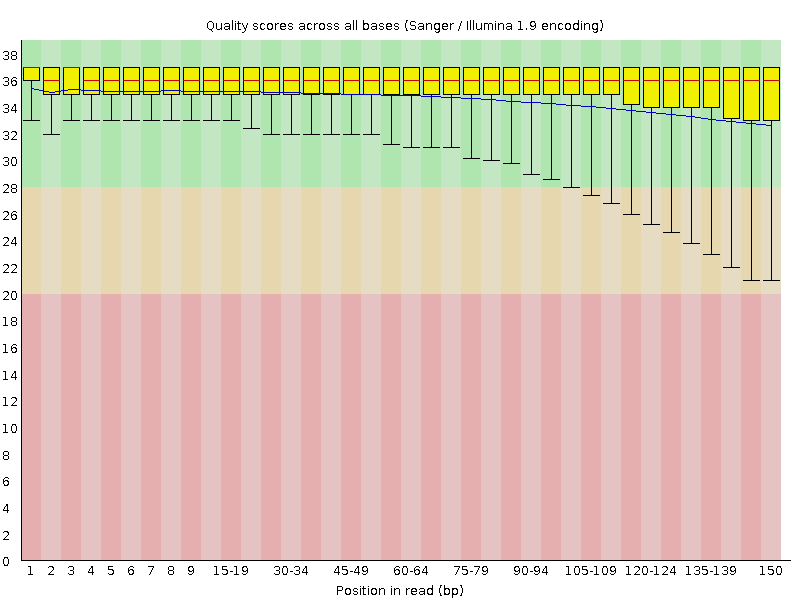
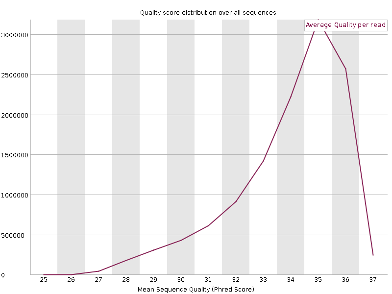
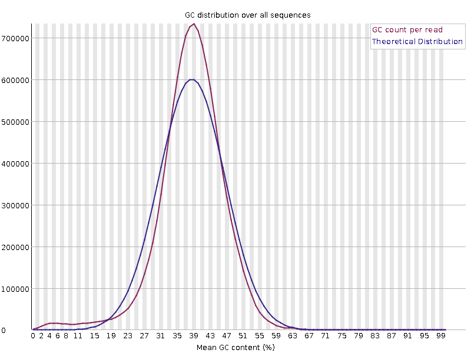
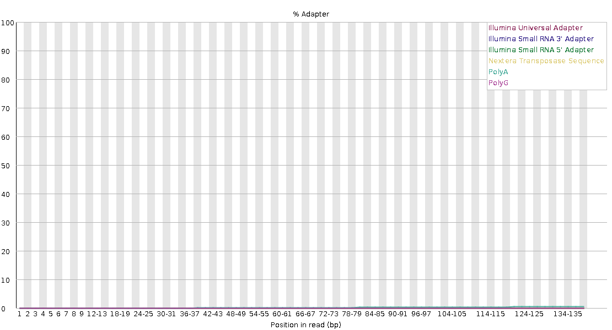
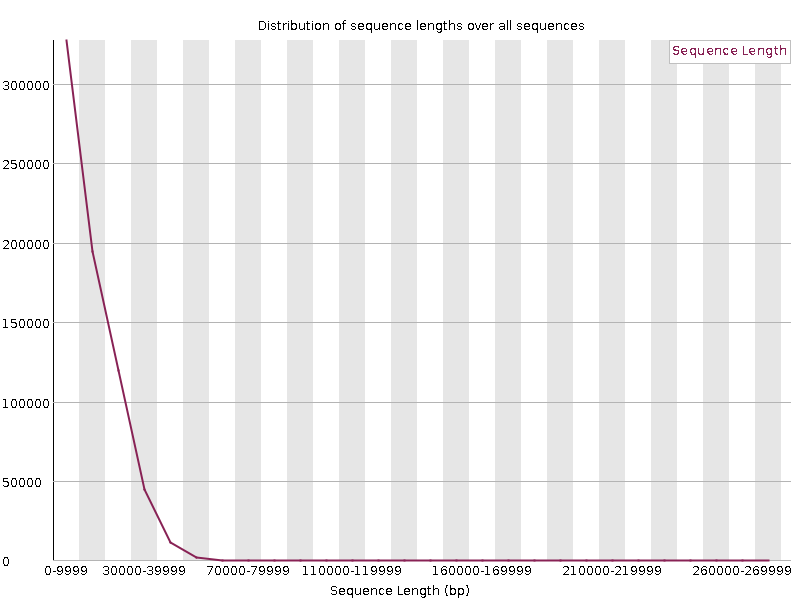
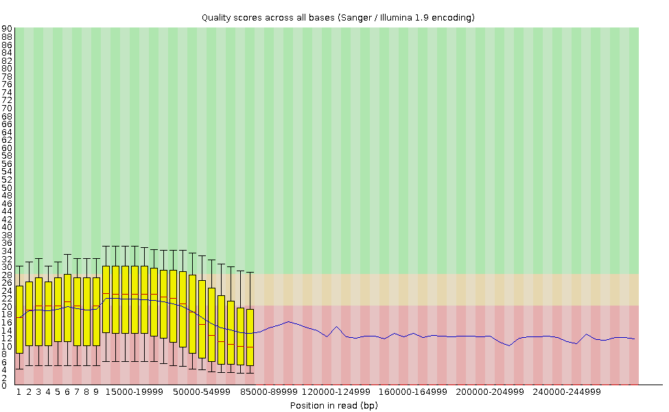

# Week 2 Session 1: QC Across Four Sequencing Platforms

Applied Bioinformatics - Tufts University Department of Biology

Last week you fetched four yeast sequencing datasets from Illumina, BGISEQ, PacBio HiFi
and Oxford Nanopore. In this lab you measure the downloaded reads and use QC tools
suited to short or long reads.

| Run | Platform | Library type |
| --- | --- | --- |
| SRR27956204 | Illumina NovaSeq 6000 | Paired-end RNA-seq |
| SRR17374239 | BGISEQ-500 | Paired-end whole-genome sequencing |
| SRR18210286 | PacBio HiFi | Single-end whole-genome sequencing |
| SRR17374240 | Oxford Nanopore | Single-end whole-genome sequencing |

**The Illumina run contains RNA-seq reads; the other three contain genomic reads.**
These are separate datasets with different BioSample records, rather than a controlled
experiment sequencing the same sample on four platforms. Differences in QC reports can
reflect platform, library type, sample preparation, and read processing. Use the
metadata when interpreting the plots; a difference between files does not establish a
platform effect.

## Before You Start

Get a compute node. This lab runs real tools and does not belong on a login node.

```bash
srun --partition=batch --nodes=1 --ntasks=1 --cpus-per-task=4 \
  --mem=16G --time=03:00:00 --pty bash
hostname
```

Set your paths:

```bash
export COURSE=/cluster/tufts/c27sp1bio0196
export MYWORK=$COURSE/$USER
export READS=$MYWORK/week-01/session-02/fetch/results/fastq

mkdir -p "$MYWORK/week-02/session-01"
cd "$MYWORK/week-02/session-01"

ls -lh "$READS"
```

You should see six files: two paired-end runs with `_1` and `_2`, and two single-file
long-read runs. Use the samplesheet in
`$MYWORK/week-01/session-02/fetch/results/samplesheet/samplesheet.csv` to match files to
runs; filenames may contain experiment identifiers rather than the run accessions above.

If that directory is empty, your download did not finish. Use the staged copies and sort
yours out afterwards:

```bash
export READS=$COURSE/shared/wk2/fallback_fastq
ls -lh "$READS"
```

Load the software:

```bash
module load seqkit fastqc nanoplot multiqc
module list
```

`module load` makes these programs available in your shell. SeqKit provides sequence
statistics, FastQC creates read-QC reports, NanoPlot plots long-read data, and MultiQC
combines existing QC results into one report. The NanoPlot command is written `NanoPlot` with capital letters, even though its
module is named `nanoplot`.

### Identify the Input Files

These are the filenames confirmed in the example download below. Use the fetchngs
samplesheet to check the two Illumina mates, two BGISEQ mates, and single PacBio and
Nanopore files. If your filenames differ, update the filename after `$READS/` while
keeping the variable names on the left.

```bash
ILLUMINA_R1="$READS/SRX23612877_SRR27956204_1.fastq.gz"
ILLUMINA_R2="$READS/SRX23612877_SRR27956204_2.fastq.gz"
BGISEQ_R1="$READS/SRX13548510_SRR17374239_1.fastq.gz"
BGISEQ_R2="$READS/SRX13548510_SRR17374239_2.fastq.gz"
PB="$READS/SRX14356846_SRR18210286.fastq.gz"
LONG="$READS/SRX13548509_SRR17374240.fastq.gz"

ls -lh "$ILLUMINA_R1" "$ILLUMINA_R2" "$BGISEQ_R1" "$BGISEQ_R2" "$PB" "$LONG"
```

All six paths should point to existing files before you continue. `$LONG` names the
Nanopore file and `$PB` names the PacBio file. These variables refer directly to the
downloaded reads; this lab does not create a separate subset.

## Part 1: Measure All Four Side by Side

### 1.1 One Command, Every Platform

Start with a numerical summary of every FASTQ file. SeqKit reads compressed
`.fastq.gz` files directly, so you do not need to decompress them first.

```bash
seqkit stats -a "$READS"/*.fastq.gz
```

| Part | Meaning |
| --- | --- |
| `seqkit stats` | Calculate sequence counts, lengths, and other statistics, with one output row per file. |
| `-a` | Show all available statistics, including length quartiles, N50, and FASTQ quality summaries. |
| `"$READS"/*.fastq.gz` | Use every filename ending in `.fastq.gz` in the input directory. The shell expands `*` to the matching filenames. |

`num_seqs` is the read count, `sum_len` is the total number of bases, and `avg_len`
is the average read length. The command prints a table in the terminal and leaves
the FASTQ files unchanged.

Fill this in from the output. One row per file.

```text
file                 num_seqs    sum_len    avg_len    N50     Q20(%)   Q30(%)
```

<details>
<summary>Example SeqKit result</summary>

This instructor-provided run processed **6 of 6 files**. The tables below preserve its
reported values, using short labels and filenames instead of the personal directory
path. All six rows have `format = FASTQ`, `type = DNA`, and `sum_gap = 0`.
SeqKit's `DNA` label describes the sequence alphabet; the Illumina libraries are still
RNA-seq, as recorded in the run metadata. On a phone, swipe across the wide tables to
see all columns.

| Label | Filename |
| --- | --- |
| Nanopore | `SRX13548509_SRR17374240.fastq.gz` |
| BGISEQ R1 | `SRX13548510_SRR17374239_1.fastq.gz` |
| BGISEQ R2 | `SRX13548510_SRR17374239_2.fastq.gz` |
| PacBio HiFi | `SRX14356846_SRR18210286.fastq.gz` |
| Illumina R1 | `SRX23612877_SRR27956204_1.fastq.gz` |
| Illumina R2 | `SRX23612877_SRR27956204_2.fastq.gz` |

**Read counts and lengths.** Lengths and total sequence are in bases.

| File | num_seqs | sum_len | min_len | avg_len | max_len |
| --- | --- | --- | --- | --- | --- |
| Nanopore | 701,791 | 9,633,074,833 | 2,000 | 13,726.4 | 276,396 |
| BGISEQ R1 | 12,142,029 | 1,821,304,350 | 150 | 150 | 150 |
| BGISEQ R2 | 12,142,029 | 1,821,304,350 | 150 | 150 | 150 |
| PacBio HiFi | 227,298 | 4,583,595,361 | 1,332 | 20,165.6 | 50,260 |
| Illumina R1 | 44,824,178 | 6,768,450,878 | 151 | 151 | 151 |
| Illumina R2 | 44,824,178 | 6,768,450,878 | 151 | 151 | 151 |

**Length distribution.** `Q2` is the median read length. `N50_num` is the number of
reads, starting with the longest, needed to reach at least half the total bases.

| File | Q1 | Q2 | Q3 | N50 | N50_num |
| --- | --- | --- | --- | --- | --- |
| Nanopore | 4,731 | 11,063 | 20,231 | 20,948 | 164,166 |
| BGISEQ R1 | 150 | 150 | 150 | 150 | 6,071,015 |
| BGISEQ R2 | 150 | 150 | 150 | 150 | 6,071,015 |
| PacBio HiFi | 15,079 | 18,738 | 23,847 | 21,020 | 84,962 |
| Illumina R1 | 151 | 151 | 151 | 151 | 22,412,089 |
| Illumina R2 | 151 | 151 | 151 | 151 | 22,412,089 |

**Quality and composition.** `Q20(%)` and `Q30(%)` are percentages of bases at or above
those quality scores. `AvgQual` is SeqKit's reported average quality, `GC(%)` is GC
percentage, and `sum_n` counts N bases.

| File | Q20(%) | Q30(%) | AvgQual | GC(%) | sum_n |
| --- | --- | --- | --- | --- | --- |
| Nanopore | 60.65 | 25.82 | 11.94 | 38 | 0 |
| BGISEQ R1 | 96.07 | 89.93 | 22.94 | 37.91 | 136,577 |
| BGISEQ R2 | 95.08 | 88.28 | 21.66 | 38.13 | 483,461 |
| PacBio HiFi | 98.47 | 96.28 | 27.46 | 37.69 | 0 |
| Illumina R1 | 97.82 | 94.29 | 26.9 | 44.89 | 88,467 |
| Illumina R2 | 97.08 | 92.99 | 25.79 | 44.63 | 55,068 |

The mate counts match: BGISEQ has **12,142,029 reads per mate**, and Illumina has
**44,824,178 reads per mate**. Your own output should be checked rather than copied
from this reference.

</details>

**Question 1.** Compare `avg_len` across the four platforms. Which two are nearly
constant, and which two vary? Why?

<details>
<summary>Answer</summary>

In this result, both **BGISEQ mates are exactly 150 bp** and both **Illumina mates
are exactly 151 bp**: their minimum, average, and maximum lengths are identical.
Their read lengths are fixed here, not merely nearly constant.

The long-read files vary:

| Dataset | min_len (bp) | avg_len (bp) | max_len (bp) |
| --- | --- | --- | --- |
| Nanopore | 2,000 | 13,726.4 | 276,396 |
| PacBio HiFi | 1,332 | 20,165.6 | 50,260 |

Short-read length is largely set by the chosen sequencing cycles. Long-read lengths
also reflect DNA fragment lengths, library preparation, size selection, and processing.
The PacBio file has the longer average read in these data; the Nanopore file has the
longest individual read.

</details>

### 1.2 Quality Is Not One Number Either

Look at the `Q20(%)` and `Q30(%)` columns.

**Question 2.** Rank the four datasets by their reported Q30. Does that ranking tell you
which platform is best?

<details>
<summary>Answer</summary>

The observed ranking by percentage of bases with Q30 or higher is:

| Rank | Dataset | Q30(%) |
| --- | --- | --- |
| 1 | PacBio HiFi | 96.28 |
| 2 | Illumina | 94.29 (R1), 92.99 (R2) |
| 3 | BGISEQ | 89.93 (R1), 88.28 (R2) |
| 4 | Nanopore | 25.82 |

PacBio ranks first in this output. This is a ranking of reported base qualities in
these files, not a universal ranking of sequencing platforms. Read length, yield, and
the biological question also matter. The Illumina dataset is RNA-seq and the others
are genomic, so they serve different purposes and differ in library preparation.

For example, the longest Nanopore read is 276,396 bp, much longer than the longest
PacBio read (50,260 bp), despite Nanopore's lower reported Q30 percentage. Week 3 uses
the PacBio HiFi genomic reads for assembly.

</details>

### 1.3 Read Length as a Distribution

An average hides the shape. Look at the real distribution for one long-read file:

`seqkit fx2tab` converts sequence records into a tab-separated table. Here we request
only read names and lengths, then summarize those lengths with the rest of the pipeline.

```bash
echo "$LONG"

seqkit fx2tab -nl "$LONG" | awk '{print $NF}' | sort -n | \
  awk '{a[NR]=$1} END {
    printf "min    %8d\n", a[1]
    printf "Q1     %8d\n", a[int(NR*0.25)]
    printf "median %8d\n", a[int(NR*0.50)]
    printf "Q3     %8d\n", a[int(NR*0.75)]
    printf "max    %8d\n", a[NR] }'
```

| Part | Meaning |
| --- | --- |
| `seqkit fx2tab` | Write one table row for each read. |
| `-n` | Keep read names without printing their sequences or quality strings. |
| `-l` | Add each read's length in bases. |
| `-nl` | A shorter way to write `-n -l`; both options apply. |
| `"$LONG"` | Read the Nanopore FASTQ file selected in the setup. |

`echo` displays the chosen filename. Each pipe (`|`) passes output to the next command.
The first `awk` extracts the final field, the read length; `sort -n` sorts the lengths
numerically. The last `awk` reports the minimum, quartiles, median, and maximum.
The backslash (`\`) continues the command on the next line.

Use the same SeqKit options for one Illumina mate file. This time, count how often
each read length occurs:

```bash
seqkit fx2tab -nl "$ILLUMINA_R1" | awk '{print $NF}' | sort -n | uniq -c | head
```

`"$ILLUMINA_R1"` selects the first Illumina mate file. `-nl` again requests names and
lengths. After extracting and sorting the lengths, `uniq -c` counts equal adjacent
values, and `head` shows the first ten length groups. The two output columns are the
number of reads and their length in bases.

**Question 3.** The short-read file gives the same length for every read. Why does that
make the mean a useful summary there and an incomplete one for long reads?

<details>
<summary>Answer</summary>

All 44,824,178 reads in the Illumina R1 file are 151 bp long. The length-count
command therefore produces one row, with a count of **44,824,178** and a length of
**151**. Each BGISEQ mate similarly contains 12,142,029 reads of 150 bp. For these
files, the mean describes every read's length.

The Nanopore file spans **2,000–276,396 bp**, with a mean of **13,726.4 bp**, a median
of **11,063 bp**, and an N50 of **20,948 bp**. Its middle half of reads falls between
Q1 = **4,731 bp** and Q3 = **20,231 bp**. The mean alone hides this broad distribution
and the very long tail.

PacBio also varies: **1,332–50,260 bp**, with a mean of **20,165.6 bp**, median of
**18,738 bp**, and N50 of **21,020 bp**. Use the distribution and N50 alongside the
mean when describing the long-read files.

</details>

**Checkpoint 1.** You have a filled-in stats table and can describe differences between
the datasets while considering both platform and library type.

## Part 2: FastQC, and Where It Applies

### 2.1 Run It on the Short Reads Only

FastQC checks each input file for patterns such as declining base quality, adapter
content, and unusual sequence composition. It creates a separate report for each
mate file and does not trim or change the reads.

```bash
mkdir -p fastqc
fastqc -t 4 --outdir fastqc \
  "$ILLUMINA_R1" "$ILLUMINA_R2" "$BGISEQ_R1" "$BGISEQ_R2"
ls fastqc/
```

| Part | Meaning |
| --- | --- |
| `mkdir -p fastqc` | Create the output directory if needed; FastQC expects it to exist. |
| `fastqc` | Run the quality-control checks on the listed input files. |
| `-t 4` | Set the processing thread limit to four, matching the four CPUs requested above. |
| `--outdir fastqc` | Save the reports in the `fastqc/` directory. `-o fastqc` means the same thing. |
| The four filename variables | Analyze the two Illumina mate files and the two BGISEQ mate files. Each file gets its own report. |
| `ls fastqc/` | List the reports that were created. |

For each input, expect an HTML report for viewing and a ZIP archive containing report
data. The backslash after `--outdir fastqc` continues the command onto the next line.

View a report through OnDemand: **Files > Home Directory**, navigate to your
`week-02/session-01/fastqc/` directory, and click an `.html` file.

### 2.2 Read It Properly

Work through these panels for one Illumina sample and write down what you see.

```text
Basic Statistics          total sequences, length, %GC
Per base sequence quality where does it start dropping?
Per base sequence content skewed at the start, or all the way through?
Per sequence GC content   one peak, or two?
Adapter content           does it rise, and from which position?
Overrepresented sequences anything named?
```

**Question 4.** Compare the Illumina and BGISEQ reports. Both are short-read platforms.
Name one panel where they differ. Why should you consider library type as well as
platform when interpreting that difference?

<details>
<summary>Answer</summary>

Any accurate observation supported by the reports earns credit. The Illumina run is
RNA-seq, while the BGISEQ run is whole-genome sequencing. Expressed transcripts are
present at different abundances, which can affect duplication and sequence composition
in RNA-seq. Higher duplication alone does not establish a library failure.

Quality profiles can also reflect sequencing chemistry and read processing; adapter
content depends on library preparation. Describe what differs, then explain plausible
causes without assigning every difference to the platform. FastQC warnings need to be
interpreted in the context of the library type.

</details>

### 2.3 Worked Example: BGISEQ Read 1

These figures come from the instructor-provided FastQC 0.12.1 report for
`SRX13548510_SRR17374239_1.fastq.gz`: **12,142,029 reads, all 150 bp long**.
You can [open the complete original report](assets/fastqc-bgiseq-r1/bgiseq-r1-fastqc.html)
to inspect the other modules. The figures below are the original report images.

**Overall finding:** base quality is generally strong, and the report has **nine PASS
modules, one WARNING, and no FAIL modules**. The warning is for the shape of the
per-sequence GC distribution. There is also a wider lower-quality tail toward the ends
of the reads. These findings support further inspection, rather than rejecting the
dataset or trimming every read to an arbitrary length.

#### Quality Along the Read



**Figure 1. Per-base sequence quality — PASS.** Each position or position range has a
red median, a yellow box containing the middle 50% of scores, and whiskers marking the
10th and 90th percentiles. The blue line is the mean. Higher scores indicate more
confident base calls.

Here the median stays near **Q36**. The mean declines gently from about **Q35 to Q33**,
while the lower whisker falls to about **Q21** near the end. Most scores remain high,
but a subset of reads has poorer-quality ends. A falling lower whisker is not the same
as all reads becoming poor. Inspect R2 and downstream results before deciding whether
quality trimming is useful; this plot does not justify discarding every read's last
several dozen bases.

#### Quality Across Whole Reads



**Figure 2. Per-sequence quality scores — PASS.** This counts reads by their mean
quality score. The largest peak is near **Q35**, with no large, separate peak of
very low-quality reads. This supports the conclusion that the file is generally
high quality, while Figure 1 shows where quality is more variable within reads.
The peak of this distribution is a different summary from the single `AvgQual` value
in the SeqKit table; do not expect those numbers to be identical.

#### The GC Warning



**Figure 3. Per-sequence GC content — WARNING.** The red curve is the observed read-GC
distribution; the blue curve is FastQC's theoretical distribution. The main peak is
around **38–40% GC**, with a sharper peak and a small excess of very low-GC reads
relative to the model. The warning concerns the **distribution's shape**, not a test
that the organism has the wrong average GC content. Basic Statistics displays an
integer GC value of 37%; the earlier SeqKit result reports 37.91% for this file.

This plot alone does **not** identify contamination. Genome composition, uneven
representation of genomic regions, library preparation, and contamination are possible
contributors to a non-model distribution. Compare R2 and, if the pattern needs further
investigation, use mapping or taxonomic evidence to distinguish those explanations.
The report finds no overrepresented sequences, which is useful context but does not
exclude all contaminants.

#### Adapter Evidence



**Figure 4. Adapter content — PASS.** The traces for the sequences tested in this
report remain close to zero, so there is no strong signal of those adapters building
up at the read ends. However, the legend lists Illumina/Nextera sequences and PolyA/PolyG;
it does not show a BGISEQ-specific adapter. A PASS therefore does not prove that every
possible library adapter is absent. Check the actual library adapter sequences if
there is other evidence of adapter contamination.

#### Other Findings and What to Do Next

- **Duplication passes.** The full report estimates that **71.03%** of sequences would remain after sequence-based deduplication. This is not a unique-mapping percentage, and the remainder cannot automatically be called PCR duplicates. Repeated sequences can also arise from sequencing a small genome deeply. Do not deduplicate solely from this FastQC estimate.
- **N content passes, but Ns are present.** The supplied SeqKit result counts **136,577 N bases**, about **0.0075%** of the 1,821,304,350 bases in this mate file. A PASS means the module did not cross its warning threshold; it does not mean zero unresolved bases.
- **Inspect both mates.** These figures cover R1 only. Check R2 before drawing conclusions about the whole paired-end library. In Session 2, compare QC before and after any justified preprocessing and record whether the suspected issue improved.

The practical decision for this report is to **keep the reads for further analysis,
inspect the GC warning, and verify adapter coverage in the checks**. Avoid treating a
warning as a diagnosis or assuming that more trimming always gives better data.

### 2.4 Try It Where It Does Not Belong

Run the same FastQC checks on the Nanopore file to examine how its report behaves
with long reads:

```bash
fastqc -t 4 -o fastqc "$LONG"
```

Here `-t 4` keeps the same thread limit, `-o fastqc` saves the report alongside the
short-read reports, and `"$LONG"` selects the Nanopore input. This is a demonstration
of tool interpretation; it does not convert or filter the reads.

Open that report. The two figures below come directly from the instructor-provided
report for `SRX13548509_SRR17374240.fastq.gz`. Its Basic Statistics table reports
**701,791 reads**, with lengths from **2,000 to 276,396 bp**. You can
[open the complete Nanopore FastQC report](assets/fastqc-nanopore/nanopore-fastqc.html)
to inspect the other checks.



**Figure 5. Read-length distribution — WARNING.** Unlike the BGISEQ reads, which
were all 150 bp, these reads vary greatly in length. Most lie near the left of the
plot, while a small number extend far to the right. FastQC warns when read lengths
are not all identical. That warning describes an expected feature of Nanopore data;
it does not by itself indicate a failed sequencing run.



**Figure 6. Per-base sequence quality — FAIL.** Read the horizontal axis carefully:
after the first few positions, labels represent large ranges of bases, rather than
consecutive single bases. The blue mean line extends far beyond the yellow
quality boxes. A position near **100,000 bp** can only include reads at least that
long; shorter reads have already ended. The far-right values therefore describe a
small subset of the library, rather than all 701,791 reads.

This plot still contains information about reported base quality, but it does not
follow the same group of reads from start to finish. A change in the curve can
reflect both quality variation and a change in which reads contribute. Do not
choose a single trimming position for every read from this plot, or conclude that
all Nanopore reads are unusable because the module says FAIL.

**Question 5.** Why does the read-length module warn, and why is the far-right end of
the quality plot difficult to interpret as a summary of the whole library?

<details>
<summary>Answer</summary>

The length warning occurs because the reads have different lengths, which is normal
for this platform. At early positions, many reads contribute quality scores; at late
positions, only the longest reads contribute. The changing set of reads makes this
different from comparing the same positions across fixed-length 150 bp reads.

FastQC's quality thresholds are not a platform-specific test of whether this library
will work for an assembly or mapping analysis. Lower reported quality may still be
real and worth investigating. Next, use NanoPlot to examine read-length and read-quality
distributions together, and use downstream results to judge whether filtering helps.

**The lesson is to interpret the plots and thresholds in context, rather than treating
every warning as a defect or dismissing every warning as harmless.**

</details>

**Checkpoint 2.** You have FastQC reports for both short-read platforms and can explain
the limitations of applying the same checks to variable-length Nanopore reads.

## Part 3: The Right Tool for Long Reads

### 3.1 NanoPlot

NanoPlot generates **plots and an HTML report**, as well as a text summary. It can
summarize both Nanopore and PacBio HiFi FASTQ reads; its name does not limit it to
Nanopore data.

```bash
mkdir -p nanoplot
NanoPlot --fastq "$LONG" -o nanoplot -t 4 --N50 --loglength
ls nanoplot/
cat nanoplot/NanoStats.txt
```

| Option | Meaning |
| --- | --- |
| `--fastq "$LONG"` | Read the selected Nanopore FASTQ file, including its stored quality scores. Compressed `.gz` input is supported. |
| `-o nanoplot` | Write the report, statistics, and plots into `nanoplot/`. |
| `-t 4` | Allow up to four processing threads, matching the compute allocation. |
| `--N50` | Add an N50 marker to the read-length histogram. |
| `--loglength` | Also produce plots with read length on a logarithmic scale. This changes the visualization, not the input reads. |

`mkdir -p` prepares the output folder, `ls` lists its contents, and `cat` displays the
text summary. These commands inspect the output without changing the reads.

The main outputs are:

| Output | What to use it for |
| --- | --- |
| `nanoplot/NanoPlot-report.html` | Open in a browser to explore the plots and summary statistics. |
| `nanoplot/NanoStats.txt` | Read the numerical summary in the terminal. |
| Other plot files in `nanoplot/` | Open individual plots; filenames and available formats depend on the installed version. |

**Open the report.** In OnDemand, choose **Files** and navigate to
`$MYWORK/week-02/session-01/nanoplot/` in your course directory. Open
`NanoPlot-report.html` in a browser. If OnDemand downloads HTML instead of displaying
it, download the output folder and open the report locally, keeping its files together.

Look for these plots:

- **Read-length distribution:** shows how many reads fall in each length range. `--N50` adds an N50 marker; at least half of the sequenced bases are in reads at least this long.
- **Read-quality distribution:** shows the spread of average quality scores across reads, when available.
- **Read length versus average quality:** shows whether longer and shorter reads have different reported qualities. The report may show points or a density view.

`--loglength` adds plots with a logarithmic length axis, making broad length ranges
easier to compare. Some quality plots may be skipped when the scores have no variation.
These plots summarize the scores stored in the FASTQ file; they do not independently
measure sequencing accuracy.

### 3.2 Five Numbers That Matter

From `NanoStats.txt`, record:

```text
Mean read length
Median read length
Read length N50
Mean read quality
Number of reads
```

**Question 6.** NanoPlot reports both mean and median read length, and they differ
substantially. Which is larger, and what does that tell you about the run?

<details>
<summary>Answer</summary>

Check the mean and median in your NanoPlot report. As a length cross-check, the
instructor's SeqKit results show:

| Dataset | Mean length (bp) | Median length (bp) |
| --- | --- | --- |
| Nanopore | 13,726.4 | 11,063 |
| PacBio HiFi | 20,165.6 | 18,738 |

The mean exceeds the median in both files, consistent with longer reads pulling the
average upward. The maximum lengths and plots help show the tail. N50 summarizes
where the bases lie, rather than the length of the middle read. These values come
from SeqKit; record the values produced by your own NanoPlot run for this question.

</details>

### 3.3 Compare the Two Long-Read Platforms

Run NanoPlot on the PacBio file as well. Use a separate output directory so its report
is easy to distinguish from the Nanopore report:

```bash
mkdir -p nanoplot_pb
NanoPlot --fastq "$PB" -o nanoplot_pb -t 4 --N50 --loglength
grep -E 'Mean read length|Median read|N50|Mean read quality' nanoplot/NanoStats.txt nanoplot_pb/NanoStats.txt
```

This command uses the same NanoPlot options: `--fastq "$PB"` selects the PacBio
file, `-o nanoplot_pb` chooses its output folder, `-t 4` sets the thread limit,
`--N50` marks N50, and `--loglength` adds logarithmic length plots. Both runs therefore
use the same plot settings. The final `grep -E` command selects matching summary lines
from the two `NanoStats.txt` files; it does not run NanoPlot again.

Open **`nanoplot_pb/NanoPlot-report.html`** for the PacBio report, using the same
OnDemand or download steps as above. Compare the read-length and quality plots with
those in `nanoplot/NanoPlot-report.html`, as well as the numbers in `NanoStats.txt`.

**Question 7.** Both are long-read platforms. Which has higher read quality, and which
has longer reads? What does that trade-off mean for choosing between them?

<details>
<summary>Answer</summary>

Use your NanoPlot plots and statistics to compare the two files. The instructor's
SeqKit output provides a reference:

| Metric | PacBio HiFi | Nanopore |
| --- | --- | --- |
| Q30(%) | 96.28 | 25.82 |
| SeqKit AvgQual | 27.46 | 11.94 |
| Average length (bp) | 20,165.6 | 13,726.4 |
| N50 (bp) | 21,020 | 20,948 |
| Maximum length (bp) | 50,260 | 276,396 |

**PacBio has higher reported quality and a longer average read in these data.** The
N50 values are similar, with PacBio slightly higher. **Nanopore has the longest
individual read.** Specify the length metric rather than saying one platform simply
has longer reads.

HiFi consensus sequencing supports high per-base accuracy. Very long Nanopore reads
can help span long repeats. The choice depends on the analysis, and these separate
libraries do not establish a universal platform ranking. Quality values above are
from SeqKit, not substituted for NanoPlot's own summary.

</details>

**Checkpoint 3.** You have opened both NanoPlot HTML reports, compared their plots and
summary statistics, and can describe the trade-off between the two datasets.

## Part 4: MultiQC — Compare All Datasets in One Report

The worked example in Section 2.3 explains one mate file in detail. **MultiQC brings
results from many files together**, making differences easier to see. It reads the QC
outputs you have already produced; it does not rerun FastQC or NanoPlot, or change the
FASTQ files.

Here we combine **four FastQC reports** (Illumina R1/R2 and BGISEQ R1/R2) with **two
NanoPlot summaries** (Nanopore and PacBio HiFi). These represent four datasets, not six
independent biological samples: R1 and R2 are mates from the same paired-end library.

### 4.1 Build the Combined Report

Run this after completing both the FastQC and NanoPlot sections:

```bash
cd "$MYWORK/week-02/session-01"
multiqc --force --dirs --dirs-depth 1 \
  --title "Week 2: QC across four platforms" --outdir multiqc \
  fastqc/*SRR27956204*_fastqc.zip \
  fastqc/*SRR17374239*_fastqc.zip \
  nanoplot/NanoStats.txt nanoplot_pb/NanoStats.txt
```

| Part | Meaning |
| --- | --- |
| `multiqc` | Collect supported QC results and build a combined report. |
| `--force` | Replace the previous report when you rerun this command. |
| `--dirs --dirs-depth 1` | Add the containing folder to report labels, keeping the two files named `NanoStats.txt` distinct. |
| `--title` | Set the report title. |
| `--outdir multiqc` | Write the report and its data into `multiqc/`. |
| The two `fastqc/*..._fastqc.zip` patterns | Select the two mate reports for each short-read run. The stars match the variable parts of the filenames. |
| The two `NanoStats.txt` paths | Include the long-read summary statistics through MultiQC's NanoStat module. |

Keep the FastQC **ZIP files**: MultiQC reads their data, rather than the standalone
FastQC HTML pages. These accession patterns also exclude the Nanopore FastQC report
created only for the tool-choice demonstration. If your report filenames differ,
adjust the patterns to select the four short-read ZIP files.

Open **`week-02/session-01/multiqc/multiqc_report.html`** through OnDemand Files, or
download it and open it in a browser. Look for both **FastQC** and **NanoStat** sections,
and confirm that both long-read datasets and all four short-read inputs are represented.
Some versions group mates in the display; expand the group to inspect R1 and R2.

### 4.2 Read the Report as a Comparison

- **General Statistics:** compare read counts, GC content, duplication and read N50 where available. Empty cells can mean that a tool does not report that metric; they do not mean zero.
- **FastQC plots:** compare the quality curves, GC distributions, adapter content and warning flags across the short-read files. Check whether an issue affects one mate, both mates, or both libraries. Use the report's sample controls to focus on a library.
- **NanoStat summaries:** compare long-read lengths, N50 and quality. MultiQC collects summary statistics; keep the original NanoPlot reports for their detailed length and quality plots.

Use the metadata when explaining differences. For example, the supplied SeqKit results
show about **45% GC for Illumina RNA-seq** and **38% for BGISEQ genomic reads**. RNA-seq
samples expressed transcripts, so the same species need not give the same GC percentage
in both libraries. A difference is a reason to investigate, not a contamination diagnosis.

**Checkpoint 4.** You have one report containing QC results from all four datasets and
can describe one difference between them. In
[Session 2, Part 3](week-02-02-trimming-and-multiqc.html#part-3-aggregate-everything),
you will extend the comparison to reads before and after preprocessing.

## Takeaways

Measure every dataset the same way first. `stats` prints one summary row per file,
`-a` includes the additional metrics, and the filename pattern selects all input FASTQs:

```bash
seqkit stats -a "$READS"/*.fastq.gz
```

Use FastQC for short reads. `-t 4` sets its thread limit, `-o fastqc` selects the
report folder, and the remaining arguments list the four short-read files:

```bash
fastqc -t 4 -o fastqc "$ILLUMINA_R1" "$ILLUMINA_R2" "$BGISEQ_R1" "$BGISEQ_R2"
```

Use NanoPlot for long reads. `--fastq` names the input, `-o` names the output folder,
`-t 4` sets the thread limit, and `--N50` adds the N50 marker:

```bash
NanoPlot --fastq "$LONG" -o nanoplot -t 4 --N50
```

Combine QC outputs with MultiQC to compare datasets, then return to the individual
reports when you need more detail. MultiQC summarizes existing results; it does not
replace the platform-appropriate QC tools.

Three things to carry forward:

1. Interpret QC with the metadata. The Illumina reads are RNA-seq; the BGISEQ, PacBio and
   Nanopore reads are genomic. Platform, library preparation and read processing all matter.
2. Match QC interpretation to the read type. FastQC flags need context for variable-length
   long reads; use NanoPlot to examine their length and quality distributions.
3. No platform is best. Accuracy, length, throughput and turnaround trade against each
   other, and which one you need is a property of your question.

## Dataset Records and QC Reference

- [Illumina RNA-seq: SRR27956204](https://www.ebi.ac.uk/ena/browser/view/SRR27956204)
- [BGISEQ genomic reads: SRR17374239](https://www.ebi.ac.uk/ena/browser/view/SRR17374239)
- [PacBio genomic reads: SRR18210286](https://www.ebi.ac.uk/ena/browser/view/SRR18210286)
- [Nanopore genomic reads: SRR17374240](https://www.ebi.ac.uk/ena/browser/view/SRR17374240)
- [FastQC: duplication and RNA-seq libraries](https://www.bioinformatics.babraham.ac.uk/projects/fastqc/Help/3%20Analysis%20Modules/8%20Duplicate%20Sequences.html)
- [FastQC: interpreting per-base quality](https://www.bioinformatics.babraham.ac.uk/projects/fastqc/Help/3%20Analysis%20Modules/2%20Per%20Base%20Sequence%20Quality.html)
- [FastQC: interpreting per-sequence quality](https://www.bioinformatics.babraham.ac.uk/projects/fastqc/Help/3%20Analysis%20Modules/3%20Per%20Sequence%20Quality%20Scores.html)
- [FastQC: read-length warnings](https://www.bioinformatics.babraham.ac.uk/projects/fastqc/Help/3%20Analysis%20Modules/7%20Sequence%20Length%20Distribution.html)
- [FastQC: GC-content warnings](https://www.bioinformatics.babraham.ac.uk/projects/fastqc/Help/3%20Analysis%20Modules/5%20Per%20Sequence%20GC%20Content.html)
- [FastQC: adapter-content checks](https://www.bioinformatics.babraham.ac.uk/projects/fastqc/Help/3%20Analysis%20Modules/10%20Adapter%20Content.html)
- [NanoPlot documentation and output descriptions](https://github.com/wdecoster/NanoPlot)
- [SeqKit command and parameter reference](https://bioinf.shenwei.me/seqkit/usage/)
- [FastQC installation and command-line usage](https://github.com/s-andrews/FastQC/blob/master/INSTALL.md)
- [MultiQC: FastQC input files](https://docs.seqera.io/multiqc/modules/fastqc/)
- [MultiQC: NanoStat and NanoPlot summaries](https://docs.seqera.io/multiqc/modules/nanostat/)
- [MultiQC: running reports and distinguishing sample names](https://docs.seqera.io/multiqc/getting_started/running_multiqc/)
