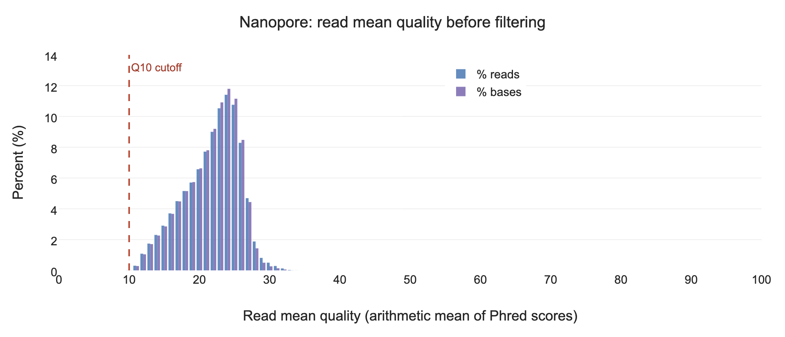
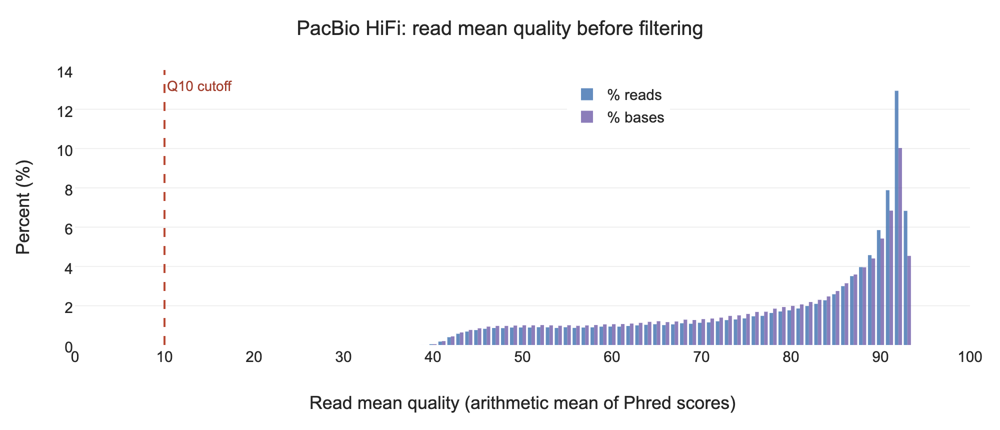
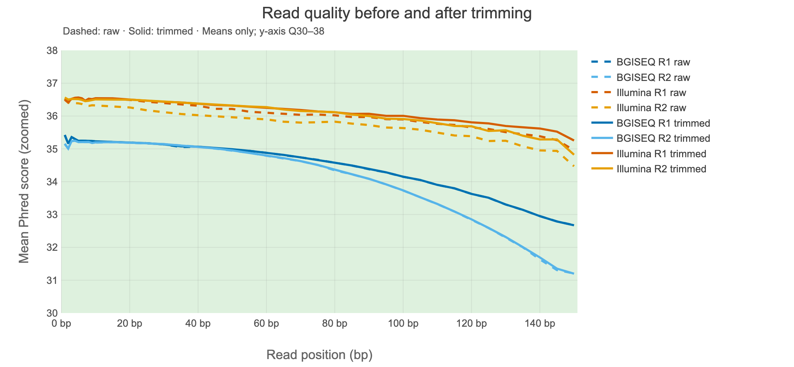
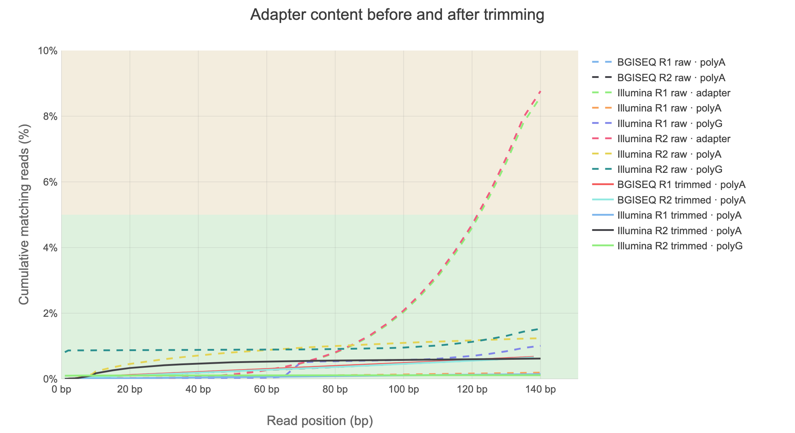

# Week 2 Session 2: Trimming, Filtering, and Reading QC Across Samples

Applied Bioinformatics - Tufts University Department of Biology

On Tuesday you measured four platforms. Today you act on what you found: trim the short
reads, clean and filter the long reads, and compare short-read QC reports before and after
trimming. Focus on what changed and whether preprocessing improved the reads.

## Before You Start

```bash
srun --partition=batch --nodes=1 --ntasks=1 --cpus-per-task=4 \
  --mem=16G --time=03:00:00 --pty bash
hostname

export COURSE=/cluster/tufts/c27sp1bio0196
export MYWORK=$COURSE/$USER
export READS=$MYWORK/week-01/session-02/fetch/results/fastq

mkdir -p "$MYWORK/week-02/session-02"
cd "$MYWORK/week-02/session-02"

ls -lh "$READS"
```

Use the original downloaded FASTQ files, as in Session 1. If `$READS` is empty,
finish the Week 1 download or use the staged FASTQ files:

```bash
export READS=$COURSE/shared/wk2/fallback_fastq
ls -lh "$READS"
```

```bash
module load seqkit fastp fastplong fastqc multiqc
module list
fastplong --version
```

Define the six input files again in this session, using your current `$READS` directory:

```bash
ILLUMINA_R1="$READS/SRX23612877_SRR27956204_1.fastq.gz"
ILLUMINA_R2="$READS/SRX23612877_SRR27956204_2.fastq.gz"
BGISEQ_R1="$READS/SRX13548510_SRR17374239_1.fastq.gz"
BGISEQ_R2="$READS/SRX13548510_SRR17374239_2.fastq.gz"
PB="$READS/SRX14356846_SRR18210286.fastq.gz"
LONG="$READS/SRX13548509_SRR17374240.fastq.gz"

ls -lh "$ILLUMINA_R1" "$ILLUMINA_R2" "$BGISEQ_R1" "$BGISEQ_R2" "$PB" "$LONG"
```

All six files should exist before you continue. If your filenames differ, update
the filenames on the right while keeping the variable names on the left.

## Part 1: Trim the Short Reads

### 1.1 Run fastp on One Sample

```bash
mkdir -p trimmed reports

S=illumina
echo "working on $S"

fastp \
  --in1 "$ILLUMINA_R1" \
  --in2 "$ILLUMINA_R2" \
  --out1 "trimmed/${S}_1.trim.fq.gz" \
  --out2 "trimmed/${S}_2.trim.fq.gz" \
  --detect_adapter_for_pe \
  --json "reports/${S}.fastp.json" \
  --html "reports/${S}.fastp.html" \
  --thread 4
```

**Extra adapter detection for paired-end reads**

Paired-end (PE) sequencing reads a DNA fragment from both ends. Adapters are artificial sequences used during library
preparation. If the biological insert is shorter than a read, sequencing can continue
into an adapter. For example:

```text
150-base read = 120 bases of biological insert + 30 bases of adapter
```

**Adapter trimming and adapter auto-detection are different:**

- **Without this flag:** fastp still trims paired-end adapters by finding where R1 and R2 overlap. Adapter trimming is enabled by default.
- **With this flag:** fastp also infers adapter sequences from input. This can trim adapters when a reliable overlap cannot be found, for example because of sequencing errors. This extra detection step is off by default for paired-end input.

We enable it here to supplement overlap-based trimming; it may remove some additional
adapter sequence and take slightly longer. It does not merge R1 and R2 or trim every
read to a fixed length. See the [fastp adapter documentation](https://github.com/OpenGene/fastp#adapters).

Open `reports/illumina.fastp.html` to inspect adapter trimming and QC before and after
processing. Later, rerun FastQC on both trimmed mates to check for remaining adapters.
Verify the output: enabling detection does not guarantee complete adapter removal.

### 1.2 How Much Survived

```bash
python3 -c "
import json, glob
d = json.load(open(sorted(glob.glob('reports/*.fastp.json'))[0]))
b = d['summary']['before_filtering']['total_reads']
a = d['summary']['after_filtering']['total_reads']
print(f'before: {b:,}')
print(f'after : {a:,}')
print(f'kept  : {100*a/b:.1f}%')
"
```

**Question 1.** You keep 97%. Is that good? What retention would worry you, and in which
direction?

<details>
<summary>Answer</summary>

97% is healthy; 95 to 99 is typical.

Below about 90% needs explaining, usually short inserts producing heavy adapter
read-through, or genuinely poor data.

But the direction people get wrong is the other one. Over-trimming is worse than
under-trimming: it removes real sequence, biases you toward reads that were easy to
sequence, and shortens reads so they map worse. Aligners already soft-clip bad ends. Trim
adapters; leave quality mostly alone.

</details>

### 1.3 Trim the Other Short-Read Sample

```bash
S=bgiseq
fastp \
  --in1 "$BGISEQ_R1" --in2 "$BGISEQ_R2" \
  --out1 "trimmed/${S}_1.trim.fq.gz" --out2 "trimmed/${S}_2.trim.fq.gz" \
  --detect_adapter_for_pe \
  --json "reports/${S}.fastp.json" --html "reports/${S}.fastp.html" \
  --thread 4
ls reports/
```

**Checkpoint 1.** Both short-read samples trimmed, with JSON and HTML reports.

## Part 2: Long Reads Are Filtered, Not Quality-Trimmed

### 2.1 Why the Difference

A short read has adapter at a predictable end and quality that decays toward the 3' end,
so trimming the ends is meaningful. A long read has errors distributed along its whole
length. Trimming the ends of a 20 kb read removes almost nothing useful and leaves the
problem untouched.

So for long reads you do two things. Remove any adapter left at the read ends, as you did
for short reads. Then make a keep-or-discard decision per read, on length and mean quality.

`fastplong` does both in one pass. It comes from the authors of `fastp` and writes the
same kind of JSON and HTML reports. It is also the first step of Week 3's assembly
pipeline, nf-core/genomeassembler, which runs it on every long-read file. The settings you
choose today are the ones you will give the pipeline.

### 2.2 Set the Thresholds Yourself

Run the same filtering command on the Nanopore and PacBio HiFi files. Each run saves
a filtered FASTQ file and its own HTML and JSON reports.

```bash
mkdir -p trimmed long_reports

for f in "$LONG" "$PB"; do
  base=$(basename "$f" .fastq.gz)
  fastplong \
    --in "$f" \
    --out "trimmed/${base}.filt.fq.gz" \
    --mean_qual 10 \
    --length_required 1000 \
    --unqualified_percent_limit 100 \
    --json "long_reports/${base}.fastplong.json" \
    --html "long_reports/${base}.fastplong.html" \
    --thread 4
  echo "filtered $base"
done
```

- `--mean_qual 10` discards reads whose average quality is below Q10.
- `--length_required 1000` discards reads shorter than 1,000 bp.
- `--unqualified_percent_limit 100` disables the default rule that rejects a read
  when more than 40% of its bases are below Q15. We use the read's average quality
  instead. Other default filters, such as filtering reads with too many N bases,
  remain enabled.
- Adapter trimming stays on, as it is by default.

The options are written out in full so that anyone reading the command knows what it did.
Week 3 gives this same set to the assembly pipeline.

### 2.3 What Was Removed

Summarize the two reports, one per long-read platform, in one table:

```bash
python3 - <<'EOF'
import json, glob, os

print(f"{'report':<34}{'reads in':>12}{'reads out':>12}{'kept':>8}{'low qual':>10}{'too short':>11}{'adapter':>9}")
for path in sorted(glob.glob("long_reports/*.fastplong.json")):
    d = json.load(open(path))
    before = d["summary"]["before_filtering"]["total_reads"]
    after = d["summary"]["after_filtering"]["total_reads"]
    failed = d["filtering_result"]
    adapter = d.get("adapter_cutting", {}).get("adapter_trimmed_reads", 0)
    name = os.path.basename(path).replace(".fastplong.json", "")
    print(f"{name:<34}{before:>12,}{after:>12,}{100*after/before:>7.1f}%"
          f"{failed['low_quality_reads']:>10,}{failed['too_short_reads']:>11,}{adapter:>9,}")
EOF
```

`low qual` and `too short` count the reads removed by each kind of rule. `adapter` counts
reads that had adapter trimmed from an end. Then compare the lengths before and after:

```bash
seqkit stats -a -j 4 "$LONG" "$PB" trimmed/*.filt.fq.gz
```

Open the `.html` files in `long_reports/` through OnDemand Files to see the length and
quality plots.

**Question 2.** Compare the before and after rows. What happened to read count, total
bases, and N50 in each file? Why did the length filter remove nothing?

<details>
<summary>Answer</summary>

**Example results from the class reports (`fastplong` 0.7.1, using the settings above):**

| Metric | Nanopore: before → after | PacBio HiFi: before → after |
|--------|--------------------------|-----------------------------|
| Reads | 701,791 → 701,785 | 227,298 → 227,298 |
| Total bases (Gb) | 9.633075 → 9.632954 | 4.583595 → 4.583595 |
| N50 (bp) | 20,948 → 20,948 | 21,020 → 21,020 |
| Minimum length (bp) | 2,000 → 2,000 | 1,332 → 1,332 |

Only **6 Nanopore reads** failed the quality filter: **99.9991% were retained**.
All HiFi reads were retained. Total bases hardly change and N50 stays the same, so
these settings have very little effect on these already processed datasets.

Neither file loses reads to the 1,000 bp length cutoff because its shortest read
is already longer than that. A filter can be working correctly and remove nothing.
Passing these lenient filters does not mean every base is high quality.

The following plots use the same axes. Blue bars count the percentage of **reads**
in each mean-quality bin; purple bars count the percentage of **bases contributed
by those reads**. The dashed line marks the Q10 cutoff.



**Nanopore:** the distribution peaks near a mean score of Q24. Almost all reads
are above Q10; the six quality failures are too few to see clearly at this scale.
The after-filtering plot looks almost identical.
[Open the full-size Nanopore figure.](assets/fastplong-long-reads/nanopore-mean-quality.png)



**PacBio HiFi:** the reported mean scores are much higher, with a peak near Q92.
All reads pass Q10, and the before/after distributions are identical. These are
averages of reported Phred scores, not a measurement of sequence accuracy.
[Open the full-size HiFi figure.](assets/fastplong-long-reads/hifi-mean-quality.png)

</details>

**Question 3.** Why should you inspect the quality distribution before choosing
`--mean_qual`? Can you compare this plot directly with SeqKit's `AvgQual`?

<details>
<summary>Answer</summary>

Q10 is a lenient starting point here: it retains almost every Nanopore read and all
HiFi reads. A higher cutoff would be stricter, but it should be chosen for the dataset
and downstream task. Retaining more reads is not automatically better, and removing
more is not automatically an improvement.

The two quality summaries use different calculations. `fastplong` uses the
[arithmetic mean of the Phred scores](https://github.com/OpenGene/fastplong/blob/main/src/filter.cpp)
within each read. [SeqKit's `AvgQual`](https://bioinf.shenwei.me/seqkit/usage/#stats)
first converts scores to error probabilities, averages those across the file, then
converts back.
Poor bases have a stronger effect on the latter. That is why the Nanopore peak near
Q24 here can coexist with an `AvgQual` of 11.94 in Session 1. Read the metric
definition before comparing numbers across tools.

</details>

**Checkpoint 2.** Both long-read files filtered with thresholds you set, and you can say
how many reads were retained from each file.

## Part 3: Aggregate Everything

### 3.1 Compare Raw and Trimmed Short Reads

```bash
mkdir -p fastqc_trimmed
fastqc -t 4 -o fastqc_trimmed trimmed/*.trim.fq.gz

multiqc --force --dirs --dirs-depth 1 --title "Week 2: raw and trimmed short reads" -o multiqc \
  "$MYWORK"/week-02/session-01/fastqc/*SRR27956204*_fastqc.zip \
  "$MYWORK"/week-02/session-01/fastqc/*SRR17374239*_fastqc.zip \
  fastqc_trimmed reports
```

Open the HTML report in `multiqc/` through OnDemand Files. The directory prefixes
keep raw and trimmed FastQC records distinct. The two accession patterns select the
four original short-read reports and exclude the Nanopore FastQC demonstration.
This report focuses on short reads before and after preprocessing. Keep the separate
NanoPlot reports for the detailed long-read results. MultiQC has no module for
`fastplong`, which is why the long-read reports went to `long_reports/` rather than
`reports/`.

### 3.2 Start at the General Statistics Table

Click the column headers to sort: **M Seqs**, **% Dups**, **% GC**, **% Passed**.

**Question 4.** You are looking at raw and trimmed versions of two platforms in one table.
What does sorting by %GC show you, and why is that reassuring?

<details>
<summary>Answer</summary>

Sorting separates the libraries: the genomic BGISEQ reads are near 38% GC, while the
Illumina RNA-seq reads are near 45% in these data. RNA-seq samples expressed
transcripts, rather than sampling the whole genome uniformly, so matching species
does not imply matching GC percentages.

Compare each library with itself. Its raw and trimmed rows should usually remain
close in GC content when preprocessing removes a modest fraction of the data. A
large shift needs an explanation from the filtering results; it is not automatically
an improvement. Agreement within each library is the reassuring comparison.

</details>

### 3.3 What One Report Cannot Show

Scroll to the overlaid per-base quality and adapter content plots.

**Question 5.** Pick one thing visible here that you could not have seen in any single
FastQC report.

<details>
<summary>Answer</summary>

The class report lets you compare **both mates, both libraries, and raw versus
trimmed reads** together. These two figures use shorter labels, dashed lines for raw
reads, and solid lines for trimmed reads. R1 and R2 are the two mates of each library.



**Quality was already high.** All plotted means stay above Q30. The BGISEQ curves
decline toward the read ends, but raw and trimmed curves almost overlap. The
Illumina RNA-seq curves improve modestly after preprocessing. The y-axis is zoomed
to Q30–38 so these small differences are visible. These are means, so they do not
show the spread of quality scores that you saw in the original FastQC box plots.
[Open the full-size quality figure.](assets/multiqc-raw-trimmed/short-read-quality-before-after.png)



**High quality scores did not rule out adapters.** The raw Illumina universal-adapter
curves (labeled `adapter`) reach about **8.6% for R1 and 8.8% for R2** near the read
ends. After trimming, those curves are below this report's **0.1% display threshold**
and are hidden; this does not prove exactly zero adapter remains. The plot is
[cumulative](https://www.bioinformatics.babraham.ac.uk/projects/fastqc/Help/3%20Analysis%20Modules/10%20Adapter%20Content.html):
a read stays counted after a match is first detected. The smaller polyA/polyG curves
are separate sequence matches, not the Illumina universal adapter.
[Open the full-size adapter figure.](assets/multiqc-raw-trimmed/short-read-adapters-before-after.png)

Together, the plots show a clear benefit from adapter removal in the Illumina
library, while the BGISEQ library changes little. The fastp summaries report that
**97.7% of Illumina reads and 99.65% of BGISEQ reads pass filtering**. Trimming an
adapter can preserve the rest of a read; it does not require discarding that read.

</details>

**Checkpoint 3.** One MultiQC report covering raw and trimmed data from both short-read
platforms.

## Takeaways

Trim short reads, filter long reads:

```bash
fastp --in1 R1.fq.gz --in2 R2.fq.gz --out1 t1.fq.gz --out2 t2.fq.gz \
      --detect_adapter_for_pe --json report.json

fastplong --in long.fastq.gz --out filt.fq.gz \
          --mean_qual 10 --length_required 1000 --unqualified_percent_limit 100 \
          --json long.fastplong.json
```

Aggregate before you decide anything:

```bash
multiqc --force -o multiqc fastqc_dir reports_dir
```

Three things to carry forward:

1. Over-trimming is worse than under-trimming. Trim adapters; leave quality mostly alone.
2. Choose quality thresholds for the platform, dataset, and downstream task. Check how
   the tool calculates quality, and write your chosen settings explicitly in the command.
3. Use MultiQC to compare raw and trimmed short-read reports. Check read retention,
   quality, and adapter content together to judge the effect of preprocessing.
